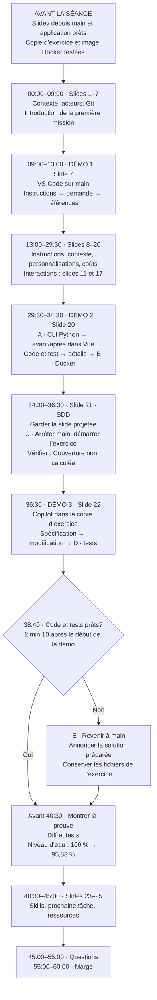

# Portable HQ — démarrage et déroulement de la présentation

**Mardi 20 octobre 2026 · fiche préparée le 19 octobre.** À garder sur le portable ou le téléphone. Sujet : GitHub Copilot dans VS Code et ses bonnes pratiques; HydroDataLab sert d’exemple vérifiable. **45 minutes de contenu, 10 minutes de questions, 5 minutes de marge.**

Cette fiche rassemble les commandes de mise à jour et les repères en séance. Pour la préparation initiale des deux copies, les prompts complets et les cas de panne, utiliser le [conducteur des démos](conducteur-demos.md). Pour connecter une copie issue du ZIP à GitHub : [synchronisation GitHub](synchronisation-github.md).

## 1. Récupérer la dernière version et reconstruire Slidev

À faire **avant la séance**, avec le réseau disponible, dans **PowerShell 7**. Adapter `$Depot` au dossier qui contient `.git`, `presentation` et `scripts`, et non à la racine du ZIP.

Arrêter l’ancien serveur Slidev avec **Ctrl+C** dans son terminal. Si HydroDataLab tourne déjà, exécuter `./scripts/stop-demo.ps1` depuis le dossier qui l’a démarré, avant la mise à jour.

**Terminal 1 — présentation :**

```powershell
$Depot = 'C:\Formation\HydroDataLab-HQ\HydroDataLab'
$ErrorActionPreference = 'Stop'
Set-Location -LiteralPath $Depot

git status --short --branch
if ($LASTEXITCODE -ne 0) { throw 'Ce dossier ne semble pas être un dépôt Git.' }
if (@(git status --porcelain).Count) {
    throw 'Enregistrer les changements locaux avant la mise à jour.'
}
git switch main
if ($LASTEXITCODE -ne 0) { throw 'Impossible de sélectionner main.' }
git pull --ff-only origin main
if ($LASTEXITCODE -ne 0) { throw 'Synchronisation interrompue.' }

$env:PLAYWRIGHT_SKIP_BROWSER_DOWNLOAD = '1'
npm.cmd --prefix presentation ci
if ($LASTEXITCODE -ne 0) { throw 'Installation interrompue.' }
npm.cmd --prefix presentation run build
if ($LASTEXITCODE -ne 0) { throw 'Compilation interrompue.' }
./scripts/start-presentation.ps1
```

**Laisser ce terminal ouvert.** Une divergence Git ou des changements locaux demandent une résolution; ne pas utiliser `reset --hard` pour contourner l’arrêt. Si `origin` n’est pas encore GitHub, suivre d’abord la fiche de synchronisation.

## 2. Ouvrir les deux vues et le conducteur

**Terminal 2 — pilotage des démos :** adapter les mêmes chemins. `$Live` désigne la copie d’exercice déjà préparée; ce bloc ne la crée pas.

```powershell
$Depot = 'C:\Formation\HydroDataLab-HQ\HydroDataLab'
$Live = Join-Path $Depot 'artifacts/repetition-live'
$ErrorActionPreference = 'Stop'
Start-Process 'http://127.0.0.1:53173/presenter/1'
Start-Process 'http://127.0.0.1:53173/1'
Start-Process (Join-Path $Depot 'handouts/conducteur-demos.html')
```

- **Portable :** vue présentateur, notes, conducteur et terminal 2.
- **Projecteur :** vue audience dans une fenêtre séparée, puis `F11`. Utiliser `Win+P` → **Étendre**.
- **Synchronisation :** même navigateur/profil, même hôte `127.0.0.1`, même port `53173` dans les deux fenêtres. Ne pas mélanger `localhost` et `127.0.0.1` pour les slides.
- Dans **Current → Slides**, vérifier une sélection de contexte en **slide 11** et les boutons des coûts en **slide 17**. Remettre le premier détail et **1 essai**, puis revenir à la slide 1.

Les adresses locales s’ouvrent sur le portable qui exécute Slidev. Elles ne permettent pas de consulter le diaporama depuis un téléphone distant. La présente fiche et le PDF peuvent y servir de repères.

## 3. Préparer les démos avant l’arrivée du public

Le dépôt principal reste sur **`main`** : dernières slides, démos 1 et 2, solution de secours. La copie `$Live` reste sur **`codex/repetition-01`**, créée depuis **`codex/preparation-demo-06`**. **Ne pas fusionner `main` dans l’exercice** : cela apporterait la solution. Aucun changement de branche n’est nécessaire pendant la séance; on change de dossier et d’application démarrée.

Installer les dépendances, démarrer avec succès chaque copie, charger l’image Docker et vérifier l’accès Copilot **avant** la séance, selon le conducteur. `-NoBuild` ne s’emploie qu’après un démarrage compilé réussi de la même version dans le même dossier. GitHub ne transporte ni les images Docker ni les dépendances : conserver le kit déjà transféré.

Dans le terminal 2, démarrer l’application principale :

```powershell
Set-Location -LiteralPath $Depot
./scripts/start-demo.ps1 -EtlEngine python
```

Ouvrir **http://localhost:53170** et le lien Aspire affiché par le script. Préparer une collecte **Jeu de démonstration**, complète et terminée. Garder la planification désactivée. Ouvrir aussi les deux dossiers dans deux fenêtres VS Code identifiables. **Le serveur Slidev du terminal 1 reste actif pendant toutes les bascules.**

## 4. Schéma de conduite

Les heures ci-dessous sont le temps écoulé depuis le début de la présentation. Les lettres **A à E** renvoient aux commandes de la section suivante.



**Si le schéma ne s’affiche pas dans votre lecteur Markdown**, les étapes suivantes reprennent tout le déroulement, dans le même ordre. Le [guide du présentateur](guide-presentateur.md) donne le minutage de chacune des 25 slides principales; les six annexes servent aux questions.

## 5. Déroulement et commandes à copier

### 09:00 · Démo 1 · slide 7 · 4 minutes

**Montrer VS Code dans `$Depot`, sur `main`.** Vérifier dossier, moteur Copilot et modèle préparé. Ouvrir **Customizations → Instructions**, montrer les règles communes et Python. Le tour des autres rubriques arrive en slide 12.

Utiliser le prompt de découverte du conducteur : repérer les indicateurs, suivre les données locales jusqu’au rapport, citer les fichiers et tests, **sans modifier les fichiers**. Vérifier une référence dans le code. Si Copilot tarde, annoncer le recours au code préparé et ouvrir `etl/hydrodatalab/pipeline.py` ainsi qu’un test.

**Retour aux slides à 13:00.** De 13:00 à 29:30, suivre les slides 8–20 et piloter les interactions contexte/coûts depuis la vue présentateur.

### A · 29:30 · Démo 2 · slide 20 · exécuter l’ETL

Dans le terminal 2, depuis `main` :

```powershell
Set-Location -LiteralPath $Depot
$Execution = uv run --project etl python -m hydrodatalab run `
    --source fixture --date 2026-10-17 --output outputs/cli |
    ConvertFrom-Json
if ($LASTEXITCODE -ne 0) { throw 'Le traitement Python a échoué.' }
$Execution.summary | Format-List
$Execution.indicators | Format-List
$Export = Join-Path 'outputs/cli' $Execution.runId
Get-Content -LiteralPath (Join-Path $Export 'hourly.csv') -TotalCount 5
```

**Montrer dans cet ordre :**

1. **Terminal :** 168 observations et 4 séries; le CSV horaire contient 24 lignes calculées.
2. **Vue → Parcours ETL :** données brutes → données normalisées → synthèse horaire. Quatre créneaux de 15 minutes deviennent une moyenne. Les onglets affichent un rapport déjà produit; ils ne lancent pas le calcul.
3. **VS Code :** une règle dans `etl/hydrodatalab/analysis.py`, puis son test dans `etl/tests/test_analysis.py`.
4. **Vue → Dernières exécutions → Voir les détails :** paramètres, étapes, durées et export rattaché à l’exécution. Un seul journal Aspire si le temps le permet.

Développer seulement la **pointe horaire moyenne : 22 009,75 MW à 18 h, Toronto**. Ce résultat est descriptif, pas une prévision. Message central : « Je peux relier le résultat de l’agent aux données, au calcul, au test et à l’exécution. »

### B · Vers 33:45 · rejouer dans Docker

L’image doit déjà être chargée :

```powershell
docker run --rm --pull never --network none `
    hydrodatalab-etl:formation `
    python -m hydrodatalab run `
    --source fixture --date 2026-10-17 --output /tmp/result
```

**Montrer :** le même cœur Python fonctionne dans un conteneur sans réseau. Si Docker est indisponible, montrer le résultat préparé en l’annonçant; ne pas installer ni télécharger pendant la séance. Ne pas démarrer Compose en parallèle : il partagerait le port de Vue et présenterait la solution complète.

### C · 34:30 · slide 21 · préparer la démo 3

**Garder la slide SDD projetée.** Dans le terminal 2, arrêter l’application principale, puis démarrer la copie d’exercice pendant les deux minutes d’explication :

```powershell
Set-Location -LiteralPath $Depot
./scripts/stop-demo.ps1
Set-Location -LiteralPath $Live
git status --short --branch
./scripts/start-demo.ps1 -NoBuild
```

Recharger Vue, lancer une collecte complète et vérifier **Couverture : Non calculée**. Passer à la fenêtre VS Code de `$Live`. Si la couverture est déjà calculée, vérifier la copie : ne pas présenter une solution achevée comme un exercice neuf.

### D · 36:30 · Démo 3 · slide 22 · déléguer et vérifier

**Montrer :** `specs/coverage.md`, `etl/hydrodatalab/coverage.py` et les tests d’acceptation dans la copie d’exercice. Copier le prompt complet de la démo 3 depuis le conducteur. Le changement demandé porte sur la couverture Python, sans recréer l’API ni Vue.

Après la modification, examiner **Changes** et la sortie réelle des tests. Au besoin, lancer :

```powershell
Set-Location -LiteralPath $Live
git diff -- etl/hydrodatalab/coverage.py
uv run --project etl pytest etl/tests specs/test_coverage_acceptance.py `
    --basetemp etl/.test-output/live
```

**À 38:40, décider :** si code et tests ne sont pas prêts, arrêter la génération et passer à **E**. Ne pas prolonger la démonstration pour déboguer.

Si les tests réussissent, retourner dans Vue et lancer **deux nouvelles collectes** : complète, puis avec **Retirer une mesure de niveau d’eau**. Dans **Qualité par série**, montrer **24/24 = 100 %**, puis **23/24 = 95,83 %**. Le taux global **99,4 %** a un autre dénominateur, 167/168. Modifier le code ne recalcule pas les anciens rapports.

### E · Secours à 38:40 · revenir à la solution préparée

Dire : **« Je passe à la solution préparée pour garder le temps de vérifier. »** Arrêter la génération Copilot, puis :

```powershell
Set-Location -LiteralPath $Live
./scripts/stop-demo.ps1
Set-Location -LiteralPath $Depot
./scripts/start-demo.ps1 -NoBuild -EtlEngine python
```

Les changements de l’exercice restent sur disque. Dans la fenêtre VS Code principale, montrer la modification préparée et ses preuves :

```powershell
Set-Location -LiteralPath $Depot
git diff 06-specification 07-solution -- etl/hydrodatalab/coverage.py
uv run --project etl pytest etl/tests specs/test_coverage_acceptance.py `
    --basetemp etl/.test-output/secours
```

Recharger Vue et montrer les deux nouvelles collectes **100 % → 95,83 %**. Si toute l’application est indisponible, utiliser les captures/exports du conducteur en annonçant qu’ils sont préparés.

### 40:30 · reprendre les slides et conclure

- **40:30–42:00 · slide 23 :** skills à explorer selon la tâche.
- **42:00–43:30 · slide 24 :** prochaine tâche personnelle; conserver les 20 secondes de réflexion silencieuse.
- **43:30–45:00 · slide 25 :** ressources, dont les liens internes HQ.
- **45:00–55:00 :** questions; garder la slide des ressources visible.
- **55:00–60:00 :** marge. Les annexes 26–31 restent disponibles selon les questions.

## Repères de secours

Le [PDF de secours](../presentation/exports/formation-hydrodatalab.pdf) s’ouvre sans serveur; il ne remplace pas les interactions synchronisées. Le [conducteur HTML](conducteur-demos.html) se lit localement sans serveur, avec les commandes et prompts à copier. Le build de Slidev et les données locales fonctionnent hors réseau après préparation; les réponses Copilot demandent son accès habituel.

**Dernier contrôle avant l’accueil :** deux vues synchronisées, slide 1, premier détail de contexte, coûts à 1 essai, `main` actif dans le dépôt principal, application Python prête, copie d’exercice et Docker déjà testés, PDF et conducteur téléchargés sur le portable.
